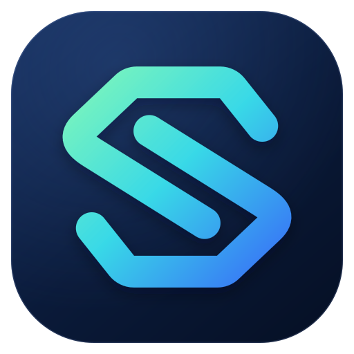

<div align="center">



# Create

**AI video and image generation platform with an OpenAI-compatible API gateway**

[中文](README_CN.md) | [日本語](README_JA.md)

</div>

## Overview

Create combines a user-facing AI creation workspace with the account, routing,
billing, and operations foundation of Sub2API. Users can generate images and
videos in the browser, archive works in object storage, and use the same
platform through OpenAI, Anthropic, Gemini, and native Seedance protocols.

The application is a single Go service that serves both the API and the
embedded Vue frontend.

## Features

- Image Studio with synchronous and asynchronous image generation.
- Video Studio with Grok and Seedance/Ark video task protocols.
- Inspiration library, temporary work shelf, and permanent user gallery.
- OpenAI, Anthropic, Gemini, Antigravity, Grok, and composite group routing.
- OAuth, API key, setup token, Bedrock, and service-account upstream accounts.
- Sticky account scheduling, concurrency limits, rate limits, and failover.
- Token, image, and video billing with usage records and subscriptions.
- Admin console for accounts, channels, users, payments, risk control, and ops.
- S3-compatible object storage for async images, inspiration mirrors, and works.
- Plugin host, audit logs, prompt audit, channel monitoring, and backups.

## Architecture

| Area | Technology |
| --- | --- |
| Backend | Go 1.27, Gin, Ent, Wire |
| Frontend | Vue 3, Vite, Pinia, TailwindCSS |
| Database | PostgreSQL |
| Cache and queues | Redis |
| Media storage | Any S3-compatible service |

Key directories:

- `backend/cmd/server`: application entry point and Wire graph.
- `backend/internal/server`: HTTP routing, middleware, and protocol endpoints.
- `backend/internal/service`: gateway, scheduling, billing, media, and domain logic.
- `backend/internal/repository`: PostgreSQL, Redis, S3, and upstream clients.
- `frontend/src/features/image-studio`: image generation workspace.
- `frontend/src/features/video-studio`: video workspace, inspiration, and works.
- `backend/migrations`: authoritative PostgreSQL schema migrations.

## Quick Start

Create a deployment environment file:

```bash
cd deploy
cp .env.example .env
```

At minimum, set stable values for:

```dotenv
POSTGRES_PASSWORD=change-me
JWT_SECRET=at-least-32-random-bytes
TOTP_ENCRYPTION_KEY=at-least-32-random-bytes
ADMIN_EMAIL=admin@example.com
ADMIN_PASSWORD=change-me-too
SERVER_PORT=9898
```

Start the self-contained stack:

```bash
docker compose -f docker-compose.create.yml up -d
```

Open `http://localhost:9898`. The first startup runs migrations and creates the
administrator from the environment variables.

Configure S3/R2 under **Admin -> Backup -> Object storage** before using async
images or relying on permanent image/video works.

See [CREATE_DEPLOY.md](deploy/CREATE_DEPLOY.md) for upgrades, rollback,
coexistence, and verification.

## Local Development

Backend:

```bash
cd backend
go test -tags=unit ./...
go run ./cmd/server
```

Frontend:

```bash
cd frontend
pnpm install
pnpm dev
```

The Vite dev server proxies `/api`, `/v1`, and `/setup` to
`http://localhost:8080` by default. Set `VITE_DEV_PROXY_TARGET` to override it.

Production frontend output is written to `backend/internal/web/dist`; the Go
binary must be built with `-tags embed` to serve it.

## Windows desktop app

The `desktop/` directory contains an Electron shell that opens the hosted Create
website, keeps the login session, and saves image, video, and other downloads to
user-selected local directories.

```powershell
cd desktop
npm install
$env:CREATE_WEB_URL = "http://localhost:9898"
npm start
```

Build the installer with:

```powershell
cd desktop
npm run dist
```

The installer is written to `desktop/release/Create-Setup-0.1.2.exe`. Desktop updates are published
through GitHub Releases and checked automatically by installed clients.

## API Entry Points

- OpenAI: `/v1/chat/completions`, `/v1/responses`, `/v1/images/*`, `/v1/videos/*`
- Anthropic: `/v1/messages`, `/v1/messages/count_tokens`
- Gemini: `/v1beta/models/*`
- Seedance/Ark: `/api/v3/contents/generations/tasks`
- Codex direct compatibility: `/backend-api/codex/*`

API keys are created in the user dashboard. Group assignment controls the
available platforms and models.

## Compatibility Boundary

This repository keeps several upstream compatibility identifiers unchanged,
including the Go module path, plugin manifest fields, Redis keys, and generated
client configuration names. These are storage or protocol contracts, not
product branding. Changing them requires a migration plan.

The displayed product name, deployment artifacts, documentation, and public
links use **Create**.

## Upstream

Create is a customized distribution built on the Sub2API codebase. The original
project and license are preserved for attribution. When syncing upstream,
review [docs/CUSTOM_FEATURES.md](docs/CUSTOM_FEATURES.md) before accepting
deletions or large refactors.

## License

See [LICENSE](LICENSE) and [CLA.md](CLA.md).
