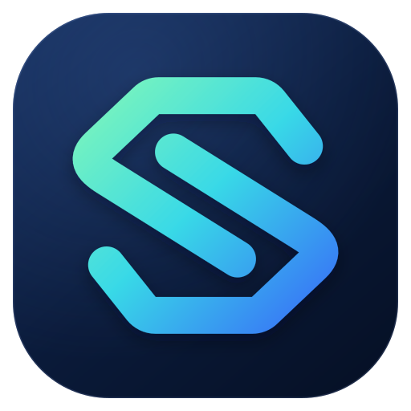

<div align="center">



# Create

**AI 视频、图片生成平台与 OpenAI 兼容 API 网关**

[English](README.md) | [日本語](README_JA.md)

</div>

## 项目定位

Create 将面向用户的 AI 创作工作台与 Sub2API 的账号池、路由、计费和运营能力
组合在一起。用户既可以在浏览器中生成图片和视频，也可以通过 OpenAI、
Anthropic、Gemini 和 Seedance 原生协议调用同一套服务。

应用是一个 Go 服务端加内嵌 Vue 前端，生产环境不需要单独部署前端。

## 主要功能

- 图片工作台：同步生图、异步生图、图片编辑、批量图片任务。
- 视频工作台：Grok 视频协议、Seedance/Ark 异步任务、参考素材。
- 灵感库、七日临时作品区、永久作品库。
- OpenAI、Anthropic、Gemini、Antigravity、Grok 与组合分组路由。
- OAuth、API Key、Setup Token、Bedrock、Service Account 等上游账号类型。
- 粘性会话、账号调度、并发控制、限流、重试和故障切换。
- Token、图片、视频计费，用量记录、订阅、余额与平台额度。
- 用户端 API Key、用量、充值、订单、邀请和渠道状态。
- 管理端账号、渠道、用户、支付、风控、审计、运维和备份。
- S3 兼容对象存储，用于异步图片、灵感素材镜像和作品归档。
- 插件宿主、提示词审计、渠道监控和系统备份。

## 技术栈

| 模块 | 技术 |
| --- | --- |
| 后端 | Go 1.27、Gin、Ent、Wire |
| 前端 | Vue 3、Vite、Pinia、TailwindCSS |
| 数据库 | PostgreSQL |
| 缓存与队列 | Redis |
| 媒体存储 | S3 / R2 / OSS / MinIO |

核心目录：

- `backend/cmd/server`：程序入口与 Wire 依赖图。
- `backend/internal/server`：路由、中间件和协议兼容层。
- `backend/internal/service`：网关、调度、计费、媒体和业务逻辑。
- `backend/internal/repository`：PostgreSQL、Redis、S3 与上游客户端。
- `frontend/src/features/image-studio`：图片工作台。
- `frontend/src/features/video-studio`：视频工作台、灵感库和作品库。
- `backend/migrations`：PostgreSQL schema 的唯一权威来源。

## 快速启动

```bash
cd deploy
cp .env.example .env
```

至少修改以下变量：

```dotenv
POSTGRES_PASSWORD=请替换
JWT_SECRET=至少32位随机字符串
TOTP_ENCRYPTION_KEY=至少32位随机字符串
ADMIN_EMAIL=admin@example.com
ADMIN_PASSWORD=请替换
SERVER_PORT=9898
```

启动独立编排：

```bash
docker compose -f docker-compose.create.yml up -d
```

打开 `http://localhost:9898`。首次启动会自动执行迁移并创建管理员账号。

异步图片、作品库和作品归档需要对象存储。上线后请先在
“管理端 -> 备份 -> 对象存储”中配置 S3/R2。

升级、回滚、同机部署和验收步骤见
[CREATE_DEPLOY.md](deploy/CREATE_DEPLOY.md)。

## 本地开发

后端：

```bash
cd backend
go test -tags=unit ./...
go run ./cmd/server
```

前端：

```bash
cd frontend
pnpm install
pnpm dev
```

开发服务器默认把 `/api`、`/v1`、`/setup` 代理到
`http://localhost:8080`，可通过 `VITE_DEV_PROXY_TARGET` 覆盖。

生产前端产物输出到 `backend/internal/web/dist`。Go 二进制必须使用
`-tags embed` 构建，才能内嵌前端。

## API 入口

- OpenAI：`/v1/chat/completions`、`/v1/responses`、`/v1/images/*`、`/v1/videos/*`
- Anthropic：`/v1/messages`、`/v1/messages/count_tokens`
- Gemini：`/v1beta/models/*`
- Seedance/Ark：`/api/v3/contents/generations/tasks`
- Codex 直连兼容：`/backend-api/codex/*`

用户在控制台创建 API Key；分组决定可用平台、模型和媒体能力。

## 兼容边界

Go module 路径、插件清单字段、Redis key、生成式客户端配置名等内部标识
继续保留上游格式。它们是数据和协议契约，不是产品品牌。修改这些标识必须
配套迁移方案。

产品展示名、部署产物、文档和公开链接统一使用 **Create**。

## 上游与许可

Create 基于 Sub2API 代码库定制，保留原项目署名与许可证。同步上游前必须
阅读 [docs/CUSTOM_FEATURES.md](docs/CUSTOM_FEATURES.md)，避免覆盖自定义
路由和依赖注入。

许可证见 [LICENSE](LICENSE) 和 [CLA.md](CLA.md)。
