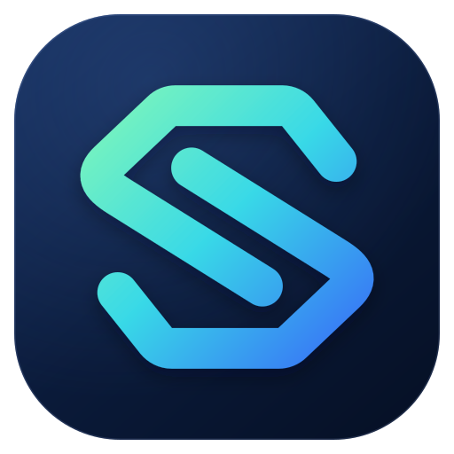

<div align="center">



# Create

**AI 動画・画像生成プラットフォーム / OpenAI 互換 API ゲートウェイ**

[English](README.md) | [中文](README_CN.md)

</div>

## 概要

Create は、AI 画像・動画の制作ワークスペースと、Sub2API 由来の
アカウント管理、ルーティング、課金、運用機能を統合したプラットフォームです。

Go サーバーが API と Vue フロントエンドを同時に配信します。

## 主な機能

- 画像スタジオ、非同期画像生成、画像編集、バッチ画像処理。
- 動画スタジオ、Grok 動画 API、Seedance/Ark 非同期タスク。
- インスピレーション、一時作品、永続作品ライブラリ。
- OpenAI、Anthropic、Gemini、Antigravity、Grok、複合グループ。
- OAuth、API Key、Bedrock、Service Account などの上流アカウント。
- スティッキーセッション、スケジューリング、同時実行制御、フェイルオーバー。
- トークン・画像・動画の課金、利用履歴、サブスクリプション。
- 管理画面、監査ログ、プロンプト監査、チャネル監視、バックアップ。
- S3 互換オブジェクトストレージ。

## クイックスタート

```bash
cd deploy
cp .env.example .env
docker compose -f docker-compose.create.yml up -d
```

`http://localhost:9898` を開きます。初回起動時にマイグレーションと管理者
作成が実行されます。

非同期画像と作品ライブラリには S3 互換ストレージの設定が必要です。
詳細は [CREATE_DEPLOY.md](deploy/CREATE_DEPLOY.md) を参照してください。

## 開発

```bash
cd backend
go test -tags=unit ./...
go run ./cmd/server
```

```bash
cd frontend
pnpm install
pnpm dev
```

本番フロントエンドは `backend/internal/web/dist` に出力され、Go バイナリは
`-tags embed` でビルドします。

## 互換性

Go module パス、プラグインフィールド、Redis キー、生成クライアント設定名は
上流互換の内部契約として維持します。表示名、配布物、ドキュメントは Create を
使用します。

## ライセンス

[LICENSE](LICENSE) と [CLA.md](CLA.md) を参照してください。
