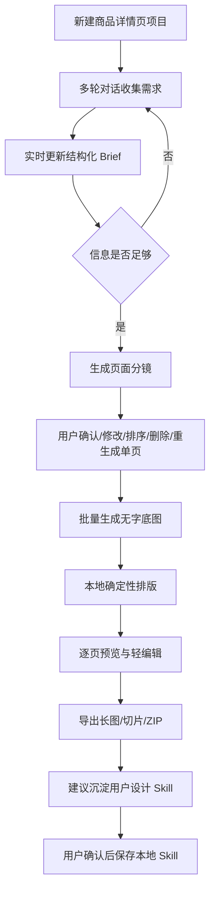

# 商品详情页工作台设计

- 状态：待用户评审
- 日期：2026-11-20
- 范围：本地优先、多轮对话策划、用户设计 Skill、电商长图生成与导出
- 本期约束：不修改版本号、不打包、不推送、不增加云端同步

## 1. 背景

Create 现有生图、生视频、无限画布、模型管理、API Key、计费和本地素材能力。新增商品详情页工作台，面向淘宝/天猫、京东、拼多多商家，将商品资料、参考图和设计偏好通过多轮对话整理成结构化 Brief，再生成分镜、无字底图、确定性排版和可上传的长图/切片。

核心判断：

- AI 负责理解需求、生成文案和视觉底图。
- 本地代码负责最终文字排版、尺寸控制、切片和导出。
- 服务器只负责鉴权、模型调用代理和计费，不保存或处理详情页图片。
- 每个用户拥有独立的本地设计 Skill，后续项目可复用其品牌、文案、视觉和页面偏好。

## 2. 目标

1. 用户可以新建一个商品详情页项目。
2. 用户可以通过多轮对话逐步补充商品、目标人群、平台、卖点和设计理念。
3. 系统实时维护结构化 Brief，并允许用户查看当前理解是否正确。
4. 信息足够后生成 6–10 页详情页分镜。
5. 用户确认或轻量修改分镜后，再批量生成无字底图。
6. 本地模板引擎完成准确文字排版、长图预览和切片导出。
7. 用户可以把本次确认的设计偏好沉淀为自己的本地 Skill。
8. 后续项目可以自动选择或手动选择用户 Skill。
9. 所有项目、对话、Skill、图片和导出文件默认保存在本机，并按用户隔离。

## 3. 非目标

本期不实现：

- 完整拖拽式设计编辑器
- 图层、蒙版和自由画布式排版
- 云端项目同步和跨设备 Skill 同步
- PSD、Figma 或可编辑设计源文件导出
- Amazon、TikTok Shop、小红书等平台预设
- 直接发布到淘宝、京东、拼多多后台
- 服务端保存、压缩或排版商品图片
- 自动学习未经用户确认的偏好
- 将整张详情页交给图片模型一次生成

## 4. 核心原则

### 4.1 对话不是最终产物

对话用于收集和澄清需求。最终进入生成链路的是结构化 Brief、分镜和 Page Spec，而不是原始聊天记录。

### 4.2 AI 图片与文字排版分离

图片模型只生成无文字底图。最终中文标题、卖点、规格、价格、认证和说明文字由本地模板引擎写入，保证可读、可复核和可重试。

### 4.3 Skill 必须可解释、可编辑

用户 Skill 是结构化的本地设计档案，不是无法理解的隐藏记忆。用户可以查看、编辑、启用、停用和删除。

### 4.4 事实优先于生成

商品事实分为：

- `user`：用户明确提供，可使用。
- `visible`：从商品图直接可见，可使用。
- `unconfirmed`：模型推测，不可进入最终成品。

未经确认的成分、尺寸、认证、销量、评价、功效和售后承诺必须阻止导出或要求用户确认。

### 4.5 本地优先

项目、对话、Skill、生成图片、排版结果和导出文件全部本地保存。模型请求只发送当前生成所需的文本和必要参考图。

## 5. 用户流程



对话期间允许用户随时点击“现在生成分镜”。系统应先展示缺失信息和模型假设，再让用户确认是否继续。

## 6. 页面与导航

新增一级页面：

- 路由：`/product-detail`
- 顶部导航名称：`商品详情`
- 顺序：生图工作台、视频工作台、无限画布、商品详情、我的资产
- 图标：使用文档/商品类图标，避免与图片、视频和画布重复

页面采用三段式布局：

1. 左侧：项目列表、我的 Skill、最近记录。
2. 中间：对话策划区。
3. 右侧：当前 Brief、分镜确认、生成状态。

桌面端右侧可切换以下标签：

- `设计想法`：展示当前结构化 Brief。
- `页面分镜`：展示页面顺序、文案、视觉说明和确认状态。
- `生成结果`：逐页预览、重试、替换图片。
- `导出`：长图、切片和 ZIP。

移动端改为顶部标签切换，不并排显示三栏。

## 7. 对话式策划

### 7.1 对话状态机

```text
discovery -> brief_ready -> storyboard_draft -> storyboard_confirmed
-> generating -> review -> completed
```

状态说明：

- `discovery`：收集商品事实、平台、人群、风格和参考素材。
- `brief_ready`：结构化 Brief 已满足分镜生成条件。
- `storyboard_draft`：已生成分镜，等待确认。
- `storyboard_confirmed`：分镜锁定，可开始生成。
- `generating`：按页生成和排版。
- `review`：单页审核、重试和替换。
- `completed`：可导出和沉淀 Skill。

### 7.2 提问规则

1. 每轮最多询问一个最关键的问题。
2. 已知信息不得重复询问。
3. 能从商品图直接确认的信息优先从图片读取，但必须标记来源。
4. 对非关键缺失项可以使用保守默认值，并在 Brief 中明确标记为假设。
5. 用户表达“先随便生成”时，允许继续，但未确认事实不得进入最终可导出版本。
6. 用户修改旧需求时，新确认内容覆盖旧内容，并在 Brief 修订记录中保留变更。

### 7.3 模型输出格式

每轮对话模型必须返回结构化结果：

```ts
type ProductDetailAssistantTurn = {
  message: string;
  briefPatch?: ProductBriefPatch;
  question?: {
    field: keyof ProductBrief;
    prompt: string;
    options?: string[];
  };
  readyToPlan: boolean;
  assumptions: string[];
  risks: string[];
  skillCandidate?: UserDesignSkillPatch;
};
```

模型不得直接输出最终 HTML、任意脚本或可执行代码。

### 7.4 上下文控制

后续请求不发送完整聊天历史，只发送：

- 当前结构化 Brief
- 最近 6–10 轮关键对话
- 用户确认和覆盖记录
- 当前选中的用户 Skill
- 当前商品缩略信息和参考图引用

避免上下文无限增长和旧需求污染。

## 8. 用户设计 Skill

### 8.1 定义

用户 Skill 是一个本地、结构化、可编辑的设计偏好档案。它不是可执行脚本，也不是整段聊天记录。

### 8.2 数据结构

```ts
type UserDesignSkill = {
  id: string;
  userId: number;
  name: string;
  description: string;
  enabled: boolean;
  scope: "global" | "category" | "platform";
  brand: {
    name?: string;
    colors: string[];
    fonts: string[];
    logoAssetId?: string;
    visualTone: string[];
  };
  copy: {
    tone: string[];
    preferredPhrases: string[];
    forbiddenPhrases: string[];
    density: "compact" | "balanced" | "rich";
  };
  layout: {
    preferredTemplates: string[];
    margins?: number;
    radius?: number;
    imageRatio?: string;
  };
  pagePatterns: Array<{
    role: ProductPageRole;
    guidance: string;
  }>;
  categoryKnowledge: string[];
  complianceRules: string[];
  referenceAssetIds: string[];
  revision: number;
  createdAt: number;
  updatedAt: number;
};
```

### 8.3 Skill 层级

应用优先级从高到低：

1. 当前项目明确要求
2. 当前项目专属 Skill 补丁
3. 用户为当前平台/类目启用的 Skill
4. 用户全局 Skill
5. 内置平台规范和安全默认值

多个 Skill 冲突时，较高优先级覆盖较低优先级；同层冲突必须在生成分镜前提示用户选择。

### 8.4 Skill 沉淀时机

只有以下时机允许生成 Skill 候选：

- 项目完成并成功导出后
- 用户点击“记住这套设计”
- 用户在对话中明确说“以后都按这个风格”

模型根据以下内容生成候选：

- 用户最终确认的品牌色、字体和视觉语气
- 用户反复要求的文案风格
- 用户选择、修改或删除的分镜
- 最终采用的模板和页面结构
- 用户明确禁止的内容
- 用户确认的类目经验

不得自动保存：

- 未确认的推测
- 一次性促销信息
- 临时价格和库存
- 支付、账户或密钥信息
- 用户未确认的商品事实
- 其他用户的对话和素材

### 8.5 Skill 确认流程

保存前显示：

- Skill 名称
- 适用范围
- 新增或修改的字段
- 来源项目
- 可能覆盖的旧规则

用户可以：

- 保存为新 Skill
- 更新现有 Skill
- 合并到现有 Skill
- 取消

## 9. 数据模型

### 9.1 Project

```ts
type ProductDetailProject = {
  id: string;
  userId: number;
  name: string;
  status: ProductDetailProjectStatus;
  platform: "taobao" | "tmall" | "jd" | "pdd";
  brief: ProductBrief;
  skillIds: string[];
  selectedTemplateId?: string;
  conversationId: string;
  storyboard?: Storyboard;
  pageSpecs: PageSpec[];
  createdAt: number;
  updatedAt: number;
  lastExportedAt?: number;
};
```

### 9.2 Brief

```ts
type ProductBrief = {
  productName: string;
  category: string;
  description: string;
  sellingPoints: FactItem[];
  targetAudience: string[];
  scenarios: string[];
  platform: ProductDetailPlatform;
  pricePosition?: "budget" | "mid" | "premium";
  visualStyle: string[];
  colorPreference: string[];
  copyTone: string[];
  forbiddenContent: string[];
  referenceAssetIds: string[];
  productAssetIds: string[];
  requiredModules: ProductPageRole[];
  assumptions: string[];
  revision: number;
};
```

### 9.3 Storyboard

```ts
type Storyboard = {
  id: string;
  revision: number;
  status: "draft" | "confirmed";
  pages: StoryboardPage[];
};

type StoryboardPage = {
  id: string;
  order: number;
  role: ProductPageRole;
  title: string;
  message: string;
  copy: PageCopyBlock[];
  visualPrompt: string;
  negativePrompt: string[];
  referenceAssetIds: string[];
  factRefs: string[];
  layoutTemplateId: string;
  status: "draft" | "generating" | "ready" | "failed";
};
```

### 9.4 Page Spec

```ts
type PageSpec = {
  id: string;
  pageId: string;
  width: number;
  height: number;
  background: string;
  layers: PageLayer[];
  overflowStatus: "ok" | "warning" | "error";
  validation: ValidationResult[];
};

type PageLayer =
  | { type: "image"; assetId: string; rect: Rect; fit: "cover" | "contain" }
  | { type: "text"; text: string; style: TextStyle; rect: Rect }
  | { type: "shape"; fill: string; radius: number; rect: Rect }
  | { type: "gradient"; colors: string[]; direction: string; rect: Rect };
```

## 10. 分镜生成

### 10.1 页面角色

```ts
type ProductPageRole =
  | "hero"
  | "pain-point"
  | "core-benefit"
  | "feature-detail"
  | "scenario"
  | "how-to-use"
  | "specification"
  | "trust"
  | "closing";
```

默认生成 6–10 页，由类目、平台和商品复杂度决定。

### 10.2 分镜规则

- 一屏只表达一个核心信息。
- 首屏必须说明商品是什么、核心价值和适用人群。
- 每个强卖点必须引用 `user` 或 `visible` 事实。
- 没有证据时省略认证、检测、销量、评价和对比模块。
- 页面文案先完整生成，再进入图片生成。
- 用户可新增、删除、排序、修改和单页重生成分镜。

### 10.3 确认门

分镜确认前禁止批量生成图片。确认后保存 `storyboard.revision`，后续生成使用该修订版本。

## 11. 无字底图生成

### 11.1 参考图策略

- 至少一张商品主图作为产品真值参考。
- 所有页面提示词重复商品锁定约束。
- 不虚构未展示的背面、内部结构、附件和包装。
- 生成尺寸按页面高度和 750px 宽度适配。

### 11.2 生成并发

- 默认并发 2 页，可在设置中调整为 1–4。
- 单页失败不影响其他页。
- 失败页保留提示词、错误原因和重试次数。
- 取消项目生成时，已成功页面保留。

### 11.3 图片状态

```text
queued -> generating -> downloaded -> review -> ready
                         \-> failed -> retry
```

图片必须完成原图落盘后才能进入排版。预览缩略图不能作为最终底图。

## 12. 本地确定性排版

### 12.1 技术选择

使用 React + HTML/CSS 模板渲染，逐页生成 DOM 后导出为位图，再用 Canvas 拼接长图。

选择原因：

- 与现有 React 技术栈一致。
- 字体、换行、边距和布局可控。
- 无需引入 Python/Pillow 打包。
- 可以复用现有桌面保存、压缩和 ZIP 能力。

排版阶段不调用图片模型。

### 12.2 模板系统

首批模板：

- 清洁美妆
- 数码科技
- 生活家居
- 食品饮料
- 服饰配件

每个模板定义：

- 页面宽度和安全边距
- 标题、正文、标签和规格样式
- 图片裁切规则
- 背景、渐变、圆角和间距
- 每类页面允许的图层结构

模板只允许结构化页面配置，不允许用户注入 HTML、CSS 或 JavaScript。

### 12.3 字体

- 默认使用系统中文字体列表，并提供确定性回退。
- 后续可以打包开源中文字体。
- 导出前检查字体是否可用。
- 字体缺失时阻止导出并提示，而不是静默替换。

### 12.4 排版校验

每页必须检查：

- 文字是否溢出
- 文本是否超出安全边距
- 图片是否加载完成
- 商品主图是否存在
- 对比度是否过低
- 页面高度是否合法
- 是否存在未确认事实引用
- 是否使用了预览图而非原图

## 13. 长图与切片导出

### 13.1 输出

- 每页 PNG 或高质量 JPEG
- 完整长图预览
- 平台可上传切片
- ZIP 包
- `manifest.json`
- 可选的 `copy.md`

### 13.2 平台预设

MVP：

| 平台 | 宽度 | 默认格式 | 备注 |
|---|---:|---|---|
| 淘宝/天猫 | 750 px | JPEG | 按当前后台规则复核体积 |
| 京东 | 750 px | JPEG | 保持文字清晰 |
| 拼多多 | 750 px | JPEG | 控制文件体积 |

平台最大高度和体积作为可配置规则，不在代码中写死。导出时如果规则未知，标记“需在商家后台确认”，但允许生成审核预览。

### 13.3 导出实现

1. 按页面模块单独截图，避免一次渲染整张超高画布。
2. 每页导出为原始分辨率的 Blob。
3. 使用 Canvas 纵向拼接长图。
4. 按预设高度切片。
5. 使用现有 `fflate` 打包 ZIP。
6. 使用桌面保存接口写入用户选择的目录。
7. 导出后写入 `manifest.json`。

## 14. 本地持久化

### 14.1 用户隔离

所有本地存储键按当前登录用户隔离，复用现有 `canvasStorageScope` 思路。

存储范围：

- `product-detail:projects:<user-scope>`
- `product-detail:conversations:<user-scope>`
- `product-detail:skills:<user-scope>`
- `product-detail:page-specs:<user-scope>`
- `product-detail:manifests:<user-scope>`

二进制图片继续使用现有本地图片/媒体存储和桌面文件保存能力。

### 14.2 删除规则

- 删除项目时先确认。
- 用户可选择只删除项目记录或同时删除本地生成图片。
- 删除 Skill 不影响已经完成的项目。
- 删除对话不自动删除项目 Brief。

### 14.3 恢复规则

- 每轮对话后自动保存。
- 应用重启后恢复未完成项目和生成任务。
- 图片生成完成后立即落盘。
- 排版结果可重新生成，不依赖云端缓存。

## 15. 界面设计要点

### 15.1 对话区

消息类型：

- 助手提问
- 用户回答
- Brief 更新卡片
- 假设与风险提示
- “生成分镜”动作卡
- 分镜确认卡
- Skill 沉淀建议卡

不展示模型内部推理。

### 15.2 Brief 区

每个字段显示：

- 当前值
- 来源：用户、图片识别、默认假设
- 最后更新时间
- 编辑入口

未确认字段使用明显但不过度打扰的标记。

### 15.3 分镜区

每张分镜卡显示：

- 页面编号和角色
- 标题与核心文案
- 视觉说明
- 引用事实
- 参考图缩略图
- 模板
- 状态
- 编辑、删除、上移、下移和单页重生成

### 15.4 结果区

- 逐页展示
- 支持打开大图查看
- 替换图片
- 刷新排版
- 单页重试
- 导出错误详情

## 16. 组件与模块边界

预期新增模块：

```text
web/src/pages/product-detail/
web/src/components/product-detail/
web/src/stores/use-product-detail-store.ts
web/src/services/product-detail/
web/src/lib/product-detail/
```

建议拆分：

- `conversation-engine`：对话状态、结构化输出和 Brief 合并。
- `skill-store`：本地 Skill CRUD、作用域和选择。
- `storyboard-service`：分镜生成、确认和修订。
- `product-image-service`：复用现有图片 API、参考图和落盘。
- `template-registry`：模板定义和平台预设。
- `layout-renderer`：Page Spec 到 DOM。
- `export-service`：截图、长图拼接、切片和 ZIP。
- `validator`：事实、尺寸、溢出、字体和文件校验。

## 17. 与现有系统的关系

### 17.1 复用

- 登录和用户信息
- API Key 管理与模型广场
- 文本模型 `/responses`
- 图片生成 API 和现有重试
- 本地图片存储、预览和桌面保存
- 用户作用域存储
- 现有 UI 组件和主题

### 17.2 不修改

- 生图工作台现有流程
- 视频工作台现有流程
- 无限画布核心数据结构
- 服务端图片处理逻辑

### 17.3 Agent Skill 关系

现有 Agent Skill 管理可以复用部分 UI 和交互模式，但商品详情页的“我的设计 Skill”是产品内的结构化本地档案，不要求用户连接本地 Codex Agent，也不是可执行 `SKILL.md`。

## 18. 错误与恢复

- 对话模型失败：保留用户输入，可重试该轮，不重复写入 Brief。
- 结构化输出无效：自动修复一次，仍失败则展示原始安全提示。
- 图片生成失败：仅重试该页。
- 图片下载中断：复用现有幂等和断线重试。
- 排版失败：保留 Page Spec，允许重新渲染。
- 导出失败：保留已生成页面，支持仅重试导出。
- 存储空间不足：阻止继续生图并提示清理旧项目或导出文件。

## 19. 安全与合规

- 不执行模型生成的 HTML、CSS、JavaScript 或命令。
- 所有模板和图层来自代码注册表。
- 用户文本在渲染前按纯文本处理。
- 不在日志中记录用户 API Key。
- Skill 不保存支付、账户、密钥和一次性私密数据。
- 高风险类目必须提示人工复核平台规则。
- 不存在真实证据时，不生成医疗功效、检测认证、销量、评价和绝对化承诺。

## 20. 测试策略

### 20.1 单元测试

- Brief 合并和冲突覆盖
- 对话结构化输出校验
- 用户 Skill 序列化和版本升级
- 用户隔离
- 分镜顺序和单页重生成
- 事实引用校验
- 字体回退和文本溢出
- 切片尺寸和 manifest

### 20.2 集成测试

- 新项目 -> 多轮对话 -> Brief -> 分镜 -> 确认
- 图片生成失败 -> 单页重试
- 排版 -> 长图 -> 切片 -> ZIP
- Skill 生成候选 -> 用户确认 -> 新项目复用
- 应用重启后恢复项目和 Skill

### 20.3 视觉测试

使用固定商品样例和固定模板，验证：

- 750px 输出
- 中文字体
- 长标题换行
- 图片裁切
- 安全边距
- 多页拼接
- 小屏预览

## 21. MVP 验收标准

1. 用户可以在本机创建、保存和恢复商品详情页项目。
2. 对话可以跨多轮更新 Brief，并显示信息来源和假设。
3. 信息足够后生成 6–10 页分镜，用户可确认、编辑、排序和删除。
4. 分镜确认后可以并行生成无字底图，失败页可以单独重试。
5. 本地排版可输出淘宝/天猫、京东和拼多多 750px 长图。
6. 支持页面图片、长图、切片、ZIP 和 manifest 导出。
7. 用户可以在项目完成后保存本地设计 Skill。
8. 新项目可以选择并应用已有 Skill。
9. 不同登录用户的数据和 Skill 不混用。
10. 删除或重启应用后，已有项目和 Skill 不丢失。
11. 未确认事实不能进入最终导出，或必须由用户明确确认。
12. 全程不要求服务器保存或处理生成图片。

## 22. 分阶段实施

### 阶段 1：基础骨架

- 新增路由和顶部导航
- 项目数据结构
- 本地用户隔离存储
- 对话与 Brief 界面
- Skill 数据结构与 CRUD

### 阶段 2：策划与分镜

- 文本模型结构化输出
- 多轮 Brief 合并
- Skill 注入
- 分镜生成、编辑和确认

### 阶段 3：图片与排版

- 无字底图生成
- 页面模板系统
- 本地排版和校验
- 单页预览和重试

### 阶段 4：导出与沉淀

- 长图、切片和 ZIP
- manifest
- Skill 候选提炼和保存
- 新项目复用 Skill

## 23. 后续扩展

不在本期实现，但数据结构预留：

- 用户 Skill 本地导入/导出
- 账号级 Skill 同步
- 更多国内和跨境平台
- 自定义模板编辑器
- PSD/Figma 导出
- 商品批量生成
- 团队模板库

## 24. 设计结论

商品详情页工作台应作为独立产品模块实现，不合并进无限画布。推荐采用“对话收集 -> 结构化 Brief -> 分镜确认 -> 无字底图 -> 本地排版 -> 长图导出 -> Skill 沉淀”的链路。

这一设计复用现有模型、登录、API Key 和本地保存能力，同时避免让服务器处理图片，符合 Create 当前本地优先架构。
